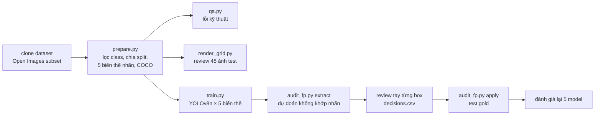

# 04 — Helmet detection: audit nhãn trước khi train, đo lỗi gán nhãn ảnh hưởng model thế nào

**Câu hỏi:** dataset "helmet detection" công khai có dùng được cho bài toán phát hiện người đi xe máy không đội mũ không, và **loại lỗi gán nhãn nào làm model hỏng nhiều nhất?**

    



## Kết luận (TL;DR)

1. **Dataset không phục vụ được bài toán gốc.** 0/1.429 ảnh có xe máy và mũ/đầu người được gán cùng nhau, vì mỗi ảnh chỉ được gán đúng 1 class. Trong mẫu 45 ảnh test xem tay, chỉ khoảng 13% là cảnh giao thông, và **6/6 ảnh có người đang đi xe đều thiếu nhãn mũ/đầu**.
2. **Test set gốc đánh giá thấp model.** 37% (34/93) "false positive" của model thực ra là vật thể **có thật nhưng bị thiếu nhãn**. Bổ sung 34 box đó vào test set thì mAP50 của model tăng từ 0.563 lên 0.602.
3. **Vẽ box ẩu hại nhất, bỏ sót box hại ít nhất** (trong 3 kiểu lỗi đã thử): box lệch tới 20% kích thước làm mAP50 giảm 11.2 điểm, nhầm class 30% giảm 6.2 điểm, bỏ sót 40% box chỉ giảm 4.6 điểm.
4. **Ranh giới class phải được định nghĩa rõ.** Trong 29 dự đoán `helmet` không khớp nhãn, 21 là sai, và 12/21 là **mũ thường**: lưỡi trai, visor, mũ cảnh sát, beret, mũ phẫu thuật, **nón lá**. Guideline cho ngữ cảnh Việt Nam bắt buộc phải nêu rõ đâu là "mũ bảo hiểm" và đâu là "mũ thường".

## Dữ liệu

| | |
|---|---|
| Nguồn | Subset Open Images (Google), lấy qua repo [TheSiddheshFulawade/YOLO-dataset-…](https://github.com/TheSiddheshFulawade/yolo-dataset-with-annotations-for-helmet-no-helmet-motorcycles-and-numberplates) |
| License | Nhãn Open Images: CC BY 4.0; ảnh: CC BY 2.0 (theo Open Images). Repo trung gian không ghi license |
| Class dùng | `helmet`, `head` (đầu người không mũ), `motorcycle`; **bỏ** biển số xe (không cần cho bài toán + tránh dữ liệu nhận dạng) |
| Kích thước | 1.429 ảnh có nhãn (494 ảnh chỉ có biển số → bỏ); chia 1.001 train / 214 val / 214 test, seed 42 |

Dữ liệu không đưa vào repo; `prepare.py` dựng lại từ bản clone.

## Phương pháp

Luồng xử lý: xem sơ đồ ở đầu README. Test "gold" = nhãn gốc + các box thiếu đã duyệt tay.

**Biến thể nhãn train** (mô phỏng lỗi annotator, test set giữ nguyên):

| Biến thể | Mô phỏng |
|---|---|
| `clean` | nhãn gốc |
| `drop20`, `drop40` | bỏ sót ngẫu nhiên 20% / 40% box |
| `flip30` | 30% box helmet↔head bị gán nhầm class |
| `jitter20` | mỗi cạnh box lệch/co giãn ngẫu nhiên tới 20% kích thước box |

Train: YOLOv8n pretrained COCO, 20 epoch, ảnh 320 px, CPU 2 nhân (~35 phút/biến thể), seed 0.

## Kết quả

### 1. Audit nhãn (trước khi train)

| Kiểm tra | Kết quả |
|---|---|
| Lỗi kỹ thuật (`qa.py`, train) | 31 box < 10 px, 1 box trùng, 0 box sai class/ngoài ảnh |
| Ảnh có ≥ 2 class cùng được gán | **0 / 1.429** |
| Review tay 45 ảnh test | 12 ảnh thiếu box (27%), 5 ảnh gán cả tranh/tượng/poster/đồ chơi (11%), 1 ảnh gán sai class (đầu robot → helmet), 6 ảnh là cảnh giao thông (13%) |

Chi tiết: `audit/label_audit_test45.csv`, `audit/qa_train.md`, ảnh minh họa `audit/label_review_example.jpg`.

Lỗi kỹ thuật thấp không có nghĩa là nhãn tốt. `qa.py` chỉ bắt được box hỏng; còn **box bị thiếu** và **ảnh lệch domain** thì chỉ phát hiện được khi nhìn bằng mắt.

### 2. Review "false positive" của model `clean` (conf ≥ 0.4, không khớp nhãn ở IoU 0.5)

| Kết luận | Số box | Ví dụ |
|---|---|---|
| Model đúng, **nhãn thiếu** | 34 (37%) | mũ bảo hiểm người đi xe máy, đầu người trong đám đông, xe máy đỗ |
| Model sai | 47 (51%) | mũ lưỡi trai/visor/nón lá → helmet; củ hành, nắm tay → head; ô tô cổ → motorcycle; gộp nhiều xe vào 1 box |
| Không chắc | 12 (13%) | đầu người trong tranh vẽ, ảnh tối/mờ, xe máy đồ chơi |

Theo class: `helmet` sai 21 / thiếu 8; `head` sai 11 / thiếu 17; `motorcycle` sai 15 / thiếu 9. Chi tiết: `audit/decisions.csv`, `audit/fp_review_example_*.jpg`.

### 3. Ảnh hưởng của lỗi gán nhãn (mAP50 trên test)

| Nhãn train | Test gốc | Test gold | Δ so với clean (gold) | mAP50-95 (gold) |
|---|---|---|---|---|
| clean | 0.563 | **0.602** | — | 0.343 |
| drop20 | 0.542 | 0.567 | −3.5 | 0.316 |
| drop40 | 0.527 | 0.557 | −4.6 | 0.302 |
| flip30 | 0.494 | 0.541 | −6.2 | 0.306 |
| jitter20 | 0.465 | 0.490 | **−11.2** | 0.245 |

Số liệu gốc: `results/*.json`.

**So what cho người gán nhãn:**
- **Box chuẩn quan trọng hơn tốc độ.** Box lệch tới 20% làm mAP50 giảm 11.2 điểm, gần gấp 2.5 lần mức thiệt hại khi bỏ sót 40% box (−4.6).
- **Nhầm class gây hại nhiều nhất ở chính class bị nhầm.** Với flip30, mAP50 của `helmet` giảm 12.0 điểm, trong khi `motorcycle` (không bị nhầm) gần như giữ nguyên.
- **Test set cũng cần QA.** Nếu không sửa test set, chính model tốt nhất cũng bị đánh giá thấp 3.9 điểm.

## Giới hạn (đọc trước khi trích số liệu)

- **1 seed / biến thể.** Chênh lệch dưới khoảng 2 điểm (ví dụ drop20 so với drop40) có thể là nhiễu. Muốn kết luận chắc hơn thì chạy 3 seed rồi báo độ lệch.
- **Test gold còn thiên lệch.** Box thiếu chỉ được tìm qua dự đoán của model `clean`, nên gold có lợi cho `clean`, và các box thiếu mà không model nào phát hiện thì vẫn còn thiếu. Vì vậy gold là "test đã sửa một phần", không phải test hoàn chỉnh.
- **Review bằng mắt trên ảnh thu nhỏ** (93 box + 45 ảnh), chỉ một người review, không đo đồng thuận. Tỉ lệ thiếu nhãn thực tế có thể còn cao hơn.
- Ảnh 320 px và 20 epoch là đủ để so sánh tương đối giữa các biến thể. Đây **không** phải model dùng được cho camera giao thông.
- Mức độ nhiễu (20%, 30%, 40%) không cân bằng giữa các loại lỗi. Đây là so sánh thô, chưa phải đường cong đầy đủ.

## Bước tiếp theo nếu muốn dùng cho bài toán thật

1. Thu thập ảnh giao thông Việt Nam (camera, dashcam), gán **đầy đủ mọi class trên mỗi ảnh** theo guideline có quy định riêng cho nón lá, mũ lưỡi trai, mũ đội trên tay.
2. Đổi thiết kế class sang `rider_helmet` / `rider_no_helmet` (gắn với người ngồi trên xe), thay vì `helmet` / `head` tách rời.
3. Gán tập gold có 2 người gán, đo IAA (`../03-quality-check/qa.py --compare`).

## Chạy lại

```bash
# môi trường CPU: pip install ultralytics (hoặc conda-forge: pytorch=*=cpu* torchvision ultralytics)
git clone --depth 1 https://github.com/TheSiddheshFulawade/yolo-dataset-with-annotations-for-helmet-no-helmet-motorcycles-and-numberplates ds
python prepare.py --src ds --out work
python ../03-quality-check/qa.py work/train_coco.json --out work/qa_train.md
python render_grid.py work/test --out work/grids --n 45
python train.py --work work --variants clean drop20 drop40 flip30 jitter20 --epochs 20 --imgsz 320
python audit_fp.py extract --work work --model work/runs/clean/weights/best.pt
#   -> điền work/audit/decisions.csv (id,verdict: missing|wrong|unsure)
python audit_fp.py apply --work work
python train.py --work work --variants clean drop20 drop40 flip30 jitter20 --imgsz 320 --test-yaml work/gold.yaml
```
